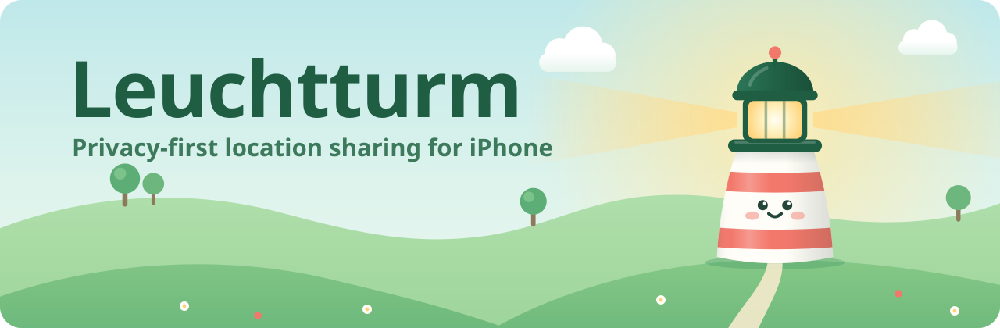
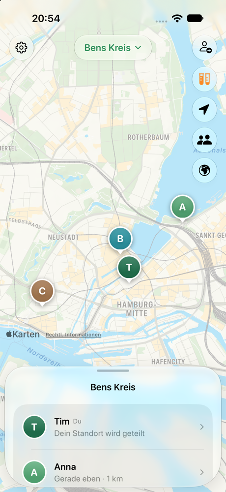

<p align="center">
  <picture>
    <source media="(prefers-color-scheme: dark)" srcset="docs/assets/banner-dark.svg">
    <source media="(prefers-color-scheme: light)" srcset="docs/assets/banner-light.svg">
    
  </picture>
</p>

<p align="center">
  <strong>Privacy-first location sharing for friends and family. End-to-end encrypted, stored in iCloud, open source.</strong>
</p>

<p align="center">
  <a href="https://github.com/Tim-Schaller/Leuchtturm/actions/workflows/ci.yml"></a>
  <a href="LICENSE"></a>
  
  
</p>

Leuchtturm is a native app for iPhone, iPad, Apple Watch and Apple TV (SwiftUI, Liquid Glass) for sharing your location with the people you choose, without handing your movements to a company that monetizes them. Everything is encrypted on the iPhone before it is stored.

<p align="center">
  
</p>

> [!NOTE]
> **Status:** beta. The features below work and are tested, and a first TestFlight build is with internal testers. Nothing is released on the App Store or independently audited yet. Do not rely on Leuchtturm for safety-critical use.

## 🌿 At a glance

In the app, a circle of people is called a *Leuchtturm* (lighthouse): you start one for your family or friends and invite them.

- **End-to-end encrypted.** Content is encrypted on the iPhone with keys Apple never sees.
- **No server of its own.** Each circle lives in the iCloud of the person who created it.
- **Honest about metadata.** Apple can see which iCloud accounts share a circle, but not what is inside it.
- **No tracking, no ads, no third-party SDKs.**
- **Open source** under the Mozilla Public License 2.0.

## 📍 Where your data lives (please read)

Leuchtturm has **no server of its own**. It stores data in **Apple iCloud (CloudKit)**: each circle lives in the iCloud of the person who created it and is shared with the members through iCloud sharing.

| | |
|---|---|
| **Apple cannot read** | names, locations, places, history, trips, chat, profile pictures and everything else you share. It is encrypted on the iPhone with keys Apple never sees. |
| **Apple can see** | which iCloud accounts are in the same circle, who created it, when data is written (location updates are more frequent while someone moves), and approximate data sizes. Apple knows the real identities behind iCloud accounts. The map itself comes from Apple Maps, which sees the map areas you look at. |
| **Location of the data** | Apple's data centers. Apple is a US company; storage in the EU is not guaranteed. |
| **Requirements** | Every member needs an iPhone signed in to iCloud. The data counts (negligibly) against the circle owner's iCloud storage. |
| **Cost** | Free. No server to run or pay for. |

There is nothing to host or run yourself. (Very early versions used a small server of their own; it was replaced by iCloud so nobody has to run hardware.) The trade-off is that Apple sees who is connected with whom (metadata), even though it cannot see content. See [docs/THREAT_MODEL.md](docs/THREAT_MODEL.md).

## ✨ Features

**Working now:**

- A family map: everyone in the circle as a pin, a people drawer with "3 min ago · 1.2 km", a circle switcher
- Live location, end-to-end encrypted and signed by each member's own iPhone, also while the app is closed (pauses when you stand still to save battery); pause sharing any time
- Battery level of everyone in the circle, with a heads-up when someone's battery is almost empty
- Places like home or school with arrival and departure alerts, checked on each iPhone itself, and a "not arrived yet" alert ("Ben is not at school by 8:15")
- SOS to your circles with your exact position, and an "Are you OK?" check after an abrupt stop while driving (no call center; call 112 in danger)
- Opt-in trips with live speed, a driving score and a weekly leaderboard for the circle
- Opt-in history: your path of the last days for your circle, kept only as long as you choose
- Fog mode: share only the rough area for a few hours
- Emoji reactions, quick notes ("Bin auf dem Weg"), check-ins and an opt-in good-morning greeting, all end-to-end encrypted and signed
- Circles with encrypted names and display names, also as temporary circles that end by themselves
- Roles: owner, admins and members; admins can take a Leuchtturm over if the owner is gone
- Chat with replies, photos, stickers and Genmoji; profile pictures, banners, own pin colour or emoji and a status that expires
- "Bin auf dem Weg" with arrival time, "Wo bist du?", "Hol mich ab", walk-home company and a meeting point in the middle
- Friends by friend code (no Leuchtturm needed), friends across all your Leuchttürme, weekly challenges, opt-in steps from Health, "a year ago today" memories (only on your iPhone) and the weather where your people are
- Widgets for the home and lock screen, a Live Activity while driving, Siri and Shortcuts
- A one-hour live link for people without the app: a web page that decrypts your position in the browser
- iPad, Apple Watch (people, SOS and check-in) and Apple TV (the family map on the big screen, end-to-end encrypted through your own iCloud)
- In German, English, French, Spanish, Italian, Dutch, Polish and Turkish
- Invites via link or QR code, with expiry
- Removing members rotates the circle key and revokes their iCloud access
- People who only obtained the iCloud share link (without the invite secret) are not admitted and are flagged to the owner
- Safety codes to verify members in person

**Planned:**

- Adaptive tracking to keep battery drain low

Safety features (live location, circles, SOS, check-in) will always be free. Optional in-app purchases only cover convenience, with no ads and no intrusive paywalls.

## 🔐 Privacy model in short

- **End-to-end encryption.** Each iPhone has its own keys (CryptoKit, iCloud Keychain by default, or only on this device if you choose). Each circle has a key distributed with HPKE. Content is encrypted before upload.
- **Cryptographic membership.** In an iCloud share any participant can write any record, so Leuchtturm does not trust iCloud for membership: the circle record is signed by the owner's device, every member record is signed by its own device, and new members prove they knew the invite secret.
- **Geofences will run on the device.** Apple will never learn where "Home" is.
- **No tracking, no ads, no third-party SDKs.**

## 📁 Repository layout

| Path | Contents |
|------|----------|
| `ios/Leuchtturm` | SwiftUI app (iOS 26+, iPhone and iPad) |
| `ios/LeuchtturmWidgets` | Widgets and Live Activity |
| `ios/LeuchtturmWatch`, `ios/LeuchtturmTV` | Apple Watch and Apple TV apps |
| `ios/LeuchtturmCore` | Crypto, record formats, CloudKit backend and client logic (Swift package; the logic also builds and is tested on Linux) |
| `docs/` | Architecture, threat model, roadmap, test vectors |

## 🔧 Building

### Core library

Swift 6, macOS or Linux:

```sh
cd ios/LeuchtturmCore
swift test
```

The tests run the full circle lifecycle, including attacks, against an in-memory CloudKit simulation.

### iOS app

macOS, Xcode 26+, Apple Developer account for iCloud:

```sh
brew install xcodegen
cd ios
xcodegen generate
open Leuchtturm.xcodeproj
```

In Xcode, select your team under *Signing & Capabilities*. The iCloud container is `iCloud.de.timschaller.leuchtturm`; forks must use their own bundle ID and container. iCloud only works on a device or simulator signed in to an Apple Account.

### Without iCloud

Debug builds have a simulation mode with three made-up people (Anna, Ben, Clara) who run the real client and crypto against the in-memory simulation. Start it with the *Leuchtturm Simulation* scheme, the launch argument `-simulation`, or the button on the setup screen. It never touches iCloud or the Keychain, and release builds do not contain it.

## 📜 License

[Mozilla Public License 2.0](LICENSE). The name "Leuchtturm" and the logo are trademarks of the project owner; see [TRADEMARKS.md](TRADEMARKS.md).

## 🤝 Contributing

Contributions are welcome. Please read [CONTRIBUTING.md](CONTRIBUTING.md) first, including the contributor license agreement.

## 🔒 Security

Please report vulnerabilities privately via GitHub's "Report a vulnerability" feature on the Security tab, not in public issues.
